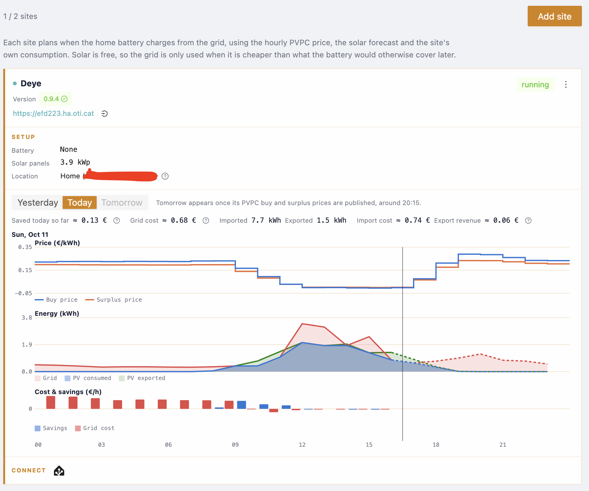
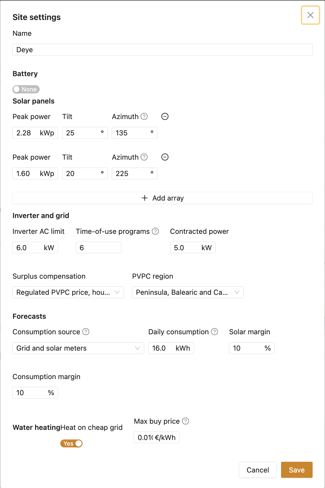
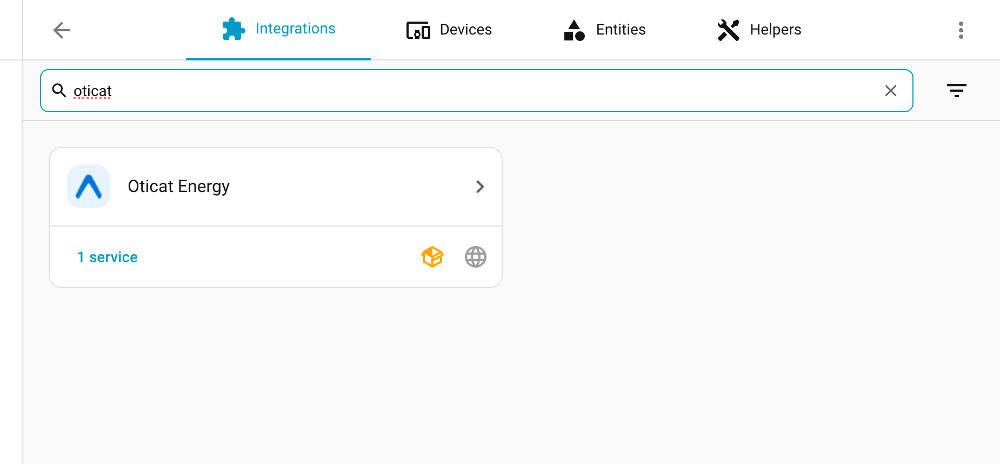
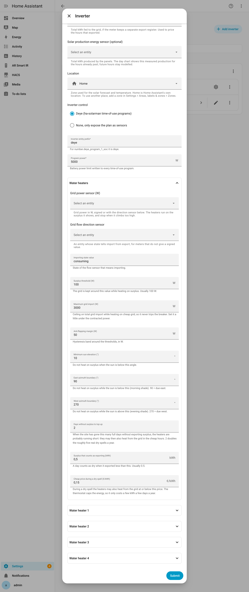
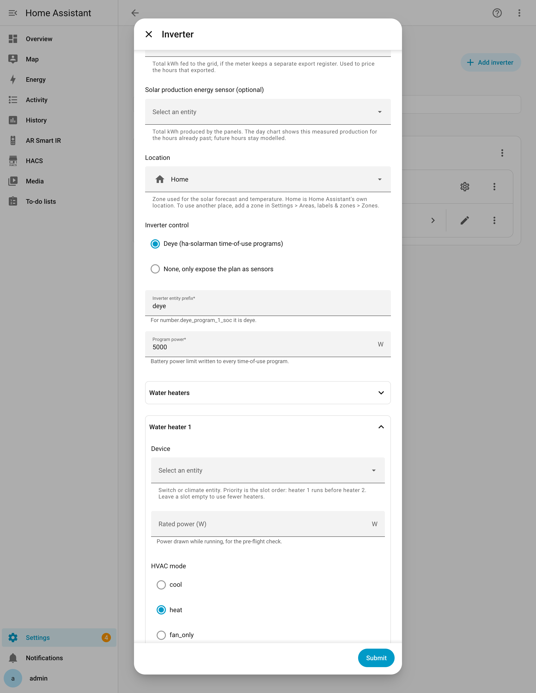
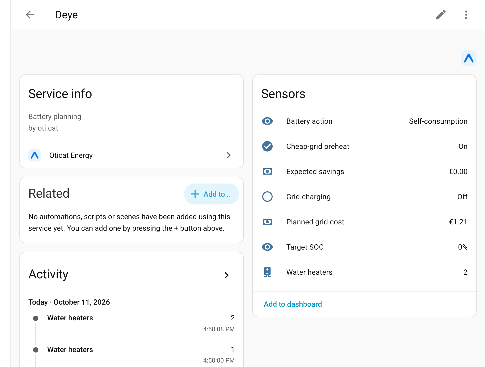

# Oticat Energy for Home Assistant

Saves you money on the electricity bill without you having to do anything: it charges your home
battery in the cheapest hours, and it heats your water with the sun. When a run of cloudy days
leaves you short of hot water, it tops the heaters up from the grid while energy is cheap.

The thinking happens in the Oticat Energy service on [dom.oti.cat](https://dom.oti.cat), with
Spanish PVPC prices, a solar forecast for your panels and your own pattern of consumption. The
integration only sends your location, your battery level and your consumption; it never opens a
connection to your inverter from the internet.

Two things it can do, each on its own site:

- **Battery** — buy grid energy only when it is cheap, and only the amount the sun will not give
  you before you need it.
- **Water heaters** — run them on solar surplus first, and top them up from the grid only when the
  sun has let you down for a few days.

You can use either one alone: a site can have a battery, water heaters, both, or neither (then it
is just sensors you can automate with).

## Contents

- [What the battery does](#what-the-battery-does)
- [What the water heaters do](#what-the-water-heaters-do)
- [Requirements](#requirements)
- [Installation](#installation)
- [Setting it up](#setting-it-up)
  - [1. Create a site on dom.oti.cat](#1-create-a-site-on-domoticat)
  - [2. Add the integration in Home Assistant](#2-add-the-integration-in-home-assistant)
  - [3. Add your inverter and its sensors](#3-add-your-inverter-and-its-sensors)
  - [4. Set up the water heaters (optional)](#4-set-up-the-water-heaters-optional)
- [The settings, in plain words](#the-settings-in-plain-words)
- [The entities you get](#the-entities-you-get)
- [How the decisions are made](#how-the-decisions-are-made)
- [What is sent to the service](#what-is-sent-to-the-service)
- [If something looks wrong](#if-something-looks-wrong)
- [License](#license)

## What the battery does

Every 15 minutes the service works out a plan for every hour whose price is known, reaching to the
end of tomorrow once tomorrow's prices come out (around 20:15). Each hour gets one of three orders:

| Order | What the battery does |
|-------|-----------------------|
| **Self-consumption** | The surplus from the panels charges it; the house draws from it down to the minimum you set |
| **Hold** | It stops discharging at a floor, so the house buys cheap grid energy now and keeps the stored energy for a dearer hour |
| **Charge from grid** | The grid tops it up to a target, on top of whatever the panels give |

It never refuses surplus to the panels and never sends battery energy to the grid. Charging is
capped by your charger's power, the maximum charge level and your contracted power. And because
every kWh taken from the battery costs a little wear, it only cycles when prices differ by more
than that.

For a **Deye** hybrid inverter the integration writes the plan straight into the inverter's six
time-of-use programs, so the inverter keeps working on its own even if Home Assistant restarts.
Without a Deye, the plan is only shown as sensors and you can automate with it yourself.

## What the water heaters do

Water heaters are the simplest storage you have: they are just a tank with a thermostat. They run
on solar surplus whenever there is any, and the house always comes first. On top of that, the
integration can heat them from the grid in two situations:

- **Free or nearly free energy** — any hour whose price is at or below the limit you set on
  dom.oti.cat (0.01 €/kWh by default).
- **After a dry spell** — when the sun has not sent any surplus out for a few days in a row, which
  means the tanks are getting cold. Then it heats from the grid in the cheap hours too, up to a
  price you choose.

No tank sensor is needed. The thermostat is what stops the heating once the tank is hot, so the
"dry spell" top-up only spends the few kWh the tank actually needs, and only a handful of days a
year.

## Requirements

- An account on [dom.oti.cat](https://dom.oti.cat) with Inverter automation enabled.
- A **site** created there for each place you want to manage. The site holds the battery, solar
  panel, grid and water-heater settings, and gives you a token.
- Home Assistant 2025.4 or newer.
- For battery control: a Deye hybrid inverter connected through the
  [ha-solarman](https://github.com/davidrapan/ha-solarman) integration. Without it the plan is only
  exposed as sensors.
- For water heaters: a sensor with the grid power in watts, and a switch (or climate entity) per
  heater.

## Installation

### HACS

1. In HACS, open the menu and choose **Custom repositories**.
2. Add `https://github.com/oticat/ha-energy` with type **Integration**.
3. Install **Oticat Energy** and restart Home Assistant.

### Manual

Copy the `custom_components/oticat_energy` folder into your Home Assistant `custom_components`
folder and restart.

## Setting it up

### 1. Create a site on dom.oti.cat

In **Inverter automation**, add a site and fill in what it needs to know about your house: the
battery, the solar panels, the grid contract and the water heaters. The site also gives you a
**token**, shown once, which is how the integration proves who it is.

Each site is one place, and it can drive one inverter and its water heaters.

### 2. Add the integration in Home Assistant

**Settings > Devices & services > Add integration > Oticat Energy.** Keep the default service URL.

### 3. Add your inverter

On the Oticat Energy entry, choose **Add inverter** and paste the **site token**. That is all this
side needs — the form asks for nothing else. Which sensors it reads and which devices it drives are
chosen on dom.oti.cat, from the list this integration reports.

Add one inverter per site. Each becomes its own device, with its own sensors.

Then go back to the site on dom.oti.cat and open **Site settings**. Everything this side does is
there, each choice in the block it belongs to — the battery SOC with the battery, the solar
production and the location with the panels, the meters with the forecasts, the water heaters and
their sensors with the high-consumption devices — and the lists come from what this integration
reports. A change reaches Home Assistant on its next check-in, within fifteen minutes.

Adding or removing an inverter here does not lose any of that: the choices live in the site, not in
the form.

### 4. Set up the water heaters (optional)

The same form has a **Water heaters** section. Open it and set the grid power sensor, then fill in
up to four heaters. The order is the priority: heater 1 runs first, and heater 2 only starts once
heater 1 has been running for a while.

Each heater is a switch (or a climate entity) with the power it draws when it is on.

You can leave the whole section empty if you only want the battery.

Only the *entities* live here, because they are local to your Home Assistant. The thresholds they
run on — the surplus, the import ceiling, the sun window and the dry-spell limits — are set on
dom.oti.cat, with the rest of the site's settings, and the integration picks them up with every
plan. Anything you set here is only used until the service sends its own, which is what lets the
heaters keep working with dom.oti.cat unreachable.

## The settings, in plain words

Most settings live on dom.oti.cat, under **Inverter automation > Edit settings**, so they are the
same wherever you open them and there is only one place to change them.

| Setting | What it means |
|---------|----------------|
| **Usable capacity** | How much energy the battery really stores, in kWh |
| **Minimum SOC** | The level the battery never goes below, so there is always a little left |
| **Max SOC from grid** | The level grid charging stops at. The sun can still fill it to 100 % |
| **Max charge / Max discharge** | How fast the battery can take and give power |
| **Round-trip efficiency** | How much of the energy you put in you get back. Typically 0.9 |
| **Wear cost** | What one kWh taken from the battery costs you in wear. The battery only cycles when prices differ by more than this |
| **Peak power / Tilt / Azimuth** | One row per array of panels, so the solar forecast knows their size and direction |
| **Inverter AC limit** | The most the inverter can put out, which caps the solar forecast |
| **Time-of-use programs** | How many programs your inverter has (a Deye has 6) |
| **Contracted power** | Your grid connection, which caps grid charging |
| **Surplus compensation** | How you are paid for energy you export: the regulated PVPC surplus price, or a fixed price |
| **PVPC region** | Peninsula and islands, or Ceuta and Melilla |
| **Consumption source** | Whether the house consumption comes from a sensor, or is worked out from the grid and solar meters |
| **Daily consumption** | A rough daily figure, used until there is a full week of real history |
| **Solar / Consumption margin** | How cautious to be: the solar forecast is cut and consumption raised by this much |
| **Program power** | The battery power limit written to every program |
| **Heat from the grid up to / Max buy price** | Which hours may heat the devices from the grid, surplus or not. On a fixed tariff you name a period; on PVPC, a price (0.01 €/kWh by default, which means only genuine surplus) |
| **Surplus threshold** | The grid is kept around this value while heating on surplus. Usually 100 W |
| **Maximum grid import** | The ceiling on total grid import while heating on cheap grid. Set it a little under your contracted power, so it never trips the breaker |
| **Anti-flapping margin** | A dead band around the thresholds, so a heater does not switch on and off around the limit |
| **Sun window** | Do not heat on surplus when the sun is too low or behind morning/evening shade |
| **Days without surplus to top up** | After this many full days without exporting surplus, the heaters are probably short, so they may also heat from the grid |
| **Surplus that counts as exporting** | A day counts as dry when it exported less than this. Usually 0.5 kWh |
| **Top up in a dry spell up to / Cheap price during a dry spell** | The most the integration will pay for grid energy during a dry spell |

| **Grid power sensor** | Grid power in watts. Positive when buying, negative when selling. If your meter gives an unsigned number, fill in the direction sensor too |
| **Grid flow direction sensor** (optional) | An entity whose state tells buying from selling |
| **Device** | The switch (or climate entity) of each heater, the power it draws when it is on, and the mode a climate one is set to. The list order is the priority |

## The entities you get

For each inverter (device named after the site):

| Entity | Meaning |
|--------|---------|
| **Battery action** | `charge`, `hold` or `self_consume` for the current hour. Its attributes hold the full plan, the inverter programs, the plan status and the current price |
| **Target SOC** | The battery level the plan is holding or charging to this hour |
| **Grid charging** | On while the plan charges the battery from the grid |
| **Cheap-grid preheat** | On in the hours whose price is at or below the "free energy" limit. Handy to automate other cheap-grid loads |
| **Water heaters** | Only when heaters are set up: how many are running, and each one's state, plus how many days it has been since the site exported surplus |
| **Expected savings** | What the plan saves compared with plain self-consumption, counting the energy left in the battery |
| **Planned grid cost** | What the plan spends on grid energy until it ends |

The **Battery action** status is `ok`, `stale` (the last request failed and an earlier plan still
applies) or `fallback` (no plan covers this hour, so the battery just self-consumes).

## How the decisions are made

Nothing here needs your attention; this is only so you can trust the numbers.

**The battery.** The service starts with the sun: whatever the panels will make before you need the
energy is free. Only the rest is bought, in the cheapest hours, and the battery is left holding
energy at the end of the plan because that energy is worth something tomorrow too. It is a
step-by-step search over the hours and the battery level, so it always finds the cheapest way to
run the house, not just the cheapest single hour.

**The water heaters.** They follow the surplus, so they almost always heat for free. The
interesting part is the days the sun does not show up. Because surplus only leaves the house once
the tanks are full, a run of days with no surplus means the tanks are running short — so that is
when the integration allows grid heating in the cheap hours. When surplus comes back, it stops.
This way the top-up happens a handful of times a year, and only when it is really needed.

## What is sent to the service

Each request sends the chosen zone's coordinates and name, your time zone, the current battery
level and the last 14 days of hourly consumption. The water heaters only add the fact that the
site exported, not what you plugged in. Nothing else leaves your home, and the service never
connects to your inverter.

## If something looks wrong

- **The battery does nothing.** Check that the action sensor has a status of `ok`. If it says
  `stale`, the service could not be reached; it keeps using the last plan. If it says `fallback`,
  there is no plan for this hour.
- **The plan never charges from the grid.** That can be right: with a flat price, or with a lot of
  sun, there is nothing to gain. Check the batteries' wear cost too.
- **The water heaters never heat from the grid.** That is usually correct: they are meant to run on
  surplus. They only buy when energy is nearly free, or after a few days without surplus. The
  **Water heaters** sensor tells you how many days it has been, and the current price.
- **A heater does not come on during a dry spell.** Check the **Maximum grid import** ceiling: if
  the house is already drawing close to it, the heater is deliberately left off.

## License

MIT
